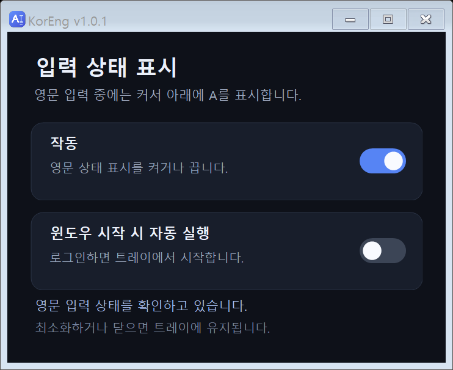

# 한/영 입력 표시기 · KorEng

Windows 11에서 **영어 입력 상태일 때만 입력 커서 아래에 작은 A**를 표시하는 트레이 프로그램입니다.

**현재 버전: 1.0.1 · Windows x64 · 별도 .NET 설치 없이 실행되는 단일 실행파일**

## 다운로드와 실행

1. [최신 배포](https://github.com/kdbp/KO-EN-Indicator/releases/latest)에서 `KorEng.exe`를 내려받으십시오.
2. 쓰기 가능한 폴더에 보관하고 실행하십시오.
3. 위쪽 **작동** 스위치로 표시 기능을 켜고 끕니다.
4. 아래쪽 **윈도우 시작 시 자동 실행** 스위치로 로그인 후 자동 실행을 설정합니다.

처음 실행하면 두 옵션이 켜져 있습니다. 창의 닫기·최소화 버튼을 누르면 트레이로 숨겨집니다. 트레이 아이콘을 **한 번 클릭**하면 창이 다시 표시되며, 완전히 종료하려면 아이콘을 오른쪽 클릭한 뒤 **종료**를 선택하십시오.



## v1.0.1 변경 사항

- 탐색기의 빈 검색란에서도 글자를 입력하기 전에 A가 표시되도록 수정했습니다.
- 탐색기의 경로 전체가 선택된 상태에서도 커서의 활성 끝을 확인하여 표시합니다.
- A 표시창을 띄우거나 다시 표시할 때 입력 초점을 가져가는 문제를 수정했습니다.
- 창의 마지막 위치·크기를 저장하고 복원하며, 다크모드 설정 창을 제공합니다.

## 지원 범위

표준 Windows 커서나 접근성 기능을 통해 커서 정보를 제공하는 앱을 지원합니다. 영어 키보드와 한국어 입력기의 영문 모드에서 A를 표시하며, 한글 모드·다른 언어·상태 확인 실패 시에는 숨깁니다.

브라우저와 편집기의 지원 여부는 해당 입력칸이 제공하는 정보에 따라 달라집니다. 독점 전체화면 게임, 자체 그리기 커서, 보호된 화면, 관리자 권한 앱, 접근성을 제공하지 않는 입력칸에서는 동작이 제한될 수 있습니다. 모든 창과 게임에서의 동작을 보장하지 않습니다.

## 개인정보와 동작 방식

- 입력한 글자, 비밀번호, 폴더 경로, 창 제목, 문서, 클립보드, 브라우저 기록을 읽거나 기록하지 않습니다.
- 네트워크 통신, 키보드 입력 기록, 화면 캡처, 프로세스 주입 기능을 사용하지 않습니다.
- 입력기 상태와 커서·입력칸의 좌표, 선택 범위의 끝점 등 표시를 위한 상태만 확인합니다.
- 탐색기의 빈 입력칸이 커서 좌표를 제공하지 않을 때는 글꼴 크기와 화면 배율을 이용하여 위치를 계산합니다.
- 느린 접근성 요청은 같은 실행파일의 별도 보조 프로세스로 처리하고, 시간 제한과 재시도 대기를 적용합니다. 작동을 끄면 보조 프로세스도 중지합니다.
- 개발용 진단 옵션을 명시적으로 실행했을 때만 탐색기 좌표와 입력 상태를 최대 1분간 기록합니다. 일반 실행에서는 진단 기록을 만들지 않습니다.

설정은 실행파일 옆의 `KorEng.settings.json`에 저장됩니다. 여기에는 작동·자동 실행 여부와 창 위치·크기가 포함됩니다. 자동 실행은 현재 사용자 시작프로그램 등록값 `KorEng`를 사용합니다. 개인 설정과 진단 기록은 저장소와 배포 파일에 포함되지 않습니다.

## 업데이트

KorEng를 트레이에서 종료한 뒤 같은 위치의 `KorEng.exe`만 교체하십시오. 설정 파일을 유지하면 설정과 바로가기를 계속 사용할 수 있습니다.

기존 v1.0.0의 `한영표시기.exe` 또는 `KoEngIndicator-v1.0.0.exe`를 사용하셨다면, 이전 프로그램의 자동 실행을 끄고 트레이에서 종료한 다음 새 `KorEng.exe`를 실행하십시오. 이전 프로그램의 설정은 자동으로 이전되지 않습니다.

## 직접 빌드하기

Windows와 [.NET 10 개발 도구](https://dotnet.microsoft.com/download/dotnet/10.0)가 필요합니다.

```bat
scripts\build.cmd --build-only
```

`dist\KorEng.exe`가 생성됩니다. 원본 프로젝트는 `src\KorEng.csproj`입니다. 빌드에 사용되는 다운로드와 중간 파일은 `.build`, `src\bin`, `src\obj`에 생성됩니다.

```bat
scripts\test.cmd
```

직접 만든 시험 창으로 검사하며 자동 실행 등록은 변경하지 않습니다. 검사 결과는 `dist\test-results`에 저장됩니다. 시험 중에는 다른 창으로 입력 초점을 옮기지 마십시오.

## 검증

- v1.0.1 단일 실행파일: 자동 검사 **50개 통과, 실패 0개**
- 실제 Windows 탐색기의 빈 검색란·경로란: 입력 전 A 표시 확인
- 입력 초점 유지, 표시·숨김·재표시, 트레이 숨김, 설정 저장·복원 검사
- 새 실행 캐시에서 설정 창 표시까지 약 0.5초

이 결과는 모든 브라우저·게임에서의 동작이나 Windows 재로그인 시험을 대신하지 않습니다. 상세 항목은 [검증결과](docs/검증결과.txt)와 [자동 검사 기록](docs/verification/verification.txt)을 참조하십시오.

## 저장소 구성

- `src/`: 프로그램 소스, 프로젝트 설정, 아이콘
- `scripts/`: 빌드·검사 실행 도구
- `docs/`: 사용 안내, 검증 결과, 설정 화면 이미지

## 라이선스

기존 저장소의 [MIT 라이선스](LICENSE)를 따릅니다.
